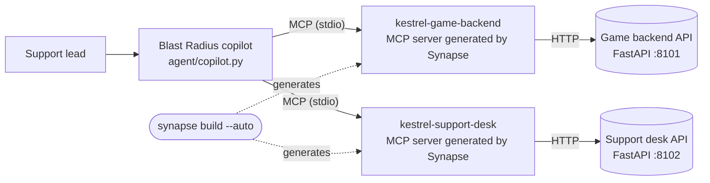

# Blast Radius — a LiveOps copilot across two systems

**Vibe-a-thon (2nd Brain Labs × Geek Room), Track 3: "A copilot that works across two systems".**

When a game server goes down, the support lead has to answer three questions fast: *who was hit, who has already written to us, and what do we owe them?* The answers live in two systems that know nothing about each other. Blast Radius is an agent that answers them by joining a **game backend** and a **support desk** through two MCP servers generated by the **Synapse CLI**.

The agent has no data access of its own. Every fact in an answer comes from a tool that Synapse generated from the source code of one of the two systems.

## One ticket, before and after `synapse build --discover`

These are recorded runs of the copilot, not mock-ups: release [`29f8435`](https://github.com/MonoYoutube/blast-radius-liveops-copilot/tree/29f84356df8fda2253927c76504c4edcd531ac7f), 20 November 2026, model `gpt-6.2-sol`, MCP servers built locally by Synapse. The question is the same both times:

> Ticket T-1042 says a Battle Pass was paid for and never arrived. Is that true, and what should we do?

| | Before | After one endpoint was added and `synapse build --discover` was run |
|---|---|---|
| Tools the agent has | 10 | 11 |
| Calls it made, in order | `desk__get_ticket` → `game__find_player_by_email` → `game__list_player_purchases` | the same three, then `game__list_incidents` → **`game__list_incident_compensations`** → `game__list_incident_affected_players` |
| First sentence of its answer | "Yes—T-1042 is confirmed: Frostbyte paid $9.99 for Battle Pass S7, and the game's purchase log records it as charged but not delivered." | "Yes—the $9.99 Battle Pass S7 purchase was charged and not delivered at first, but Live Ops later recorded a re-delivery." |

What happens in the first two calls is the whole point of the track. The ticket comes from `t.sadykov@example.org`. The support desk has no player ids; the game backend knows this person as Frostbyte (`P-1002`) with a different primary address and this one linked. Only after that join can the purchase log be read: `PU-5001`, charged at 18:41 UTC during the outage, not delivered.

With ten tools that is all the agent can establish, and it has to leave open whether anything was done about it afterwards. The eleventh tool reads the compensation ledger, where `C-9003` records a re-delivery for exactly that purchase on 19 November. The support lead now replies to the player instead of granting the pass a second time. No manual client restart was needed; the next question opened a fresh MCP session.

The first question of the demo, from the same recording session, joins in the other direction (`game__get_incident` → `game__list_incident_affected_players` → `desk__list_tickets_awaiting_first_response` → `desk__search_tickets`): "INC-2026-11-18-EU2 affected 7 players; 4 wrote to support after it started, and 2 are still waiting for a first reply: Frostbyte and IronTulip."

You can check the joins and the tool-list change yourself in a few minutes, without a model and without an account: [Quick start](#quick-start), then [Live update](#live-update-a-new-endpoint-becomes-a-tool). All people, addresses and purchases in this repository are invented.



## The scenario

Kestrel Arena is a fictional online game. On 18 November its EU-2 match servers crashed for 75 minutes, and purchases made on EU-2 in that window were charged but not delivered.

| System | Codebase | Knows | Does not know |
|---|---|---|---|
| Game backend | `systems/game_backend` | incidents, players, match sessions, purchases | anything about tickets |
| Support desk | `systems/support_desk` | tickets and conversations, by requester e-mail | player ids, purchases, incidents |

The only bridge is a person's e-mail address, and a player may write from a linked address that is not their primary one. That is what makes the join worth checking.

### Questions the demo answers

1. **Incident → tickets.** "Which players were affected by the EU-2 outage, and which of them have written to support since it started? Who is still waiting for a first reply?"
2. **Ticket → purchases.** "Ticket T-1042 says a Battle Pass was paid for and never arrived. Is that true?" The purchase log confirms the charge without delivery. "Ticket T-1047 says the Battle Pass was charged twice. Is that true?" It was charged once.
3. **After a live update.** A developer adds a compensations endpoint to the game backend, runs `synapse build --discover`, and the agent can answer "who has already been compensated, and which purchases do we still owe?"

## Quick start

Requirements: **Python 3.12+**, **Node.js 20+** and the Synapse CLI (`npm install -g @2ndbrainlabs-ai/synapse-cli`, tested with 0.1.9). Steps 1 to 4 need no Synapse account and no model key.

**1. Environment.** Linux and macOS:

```bash
python3 -m venv .venv
source .venv/bin/activate
python -m pip install -r requirements.txt
```

Windows PowerShell (5.1 or newer; any installed Python 3.12+ works in the first line):

```powershell
py -3.12 -m venv .venv
Set-ExecutionPolicy -Scope Process -ExecutionPolicy Bypass -Force
.venv\Scripts\Activate.ps1
python -m pip install -r requirements.txt
```

Every command in this README is a single line, is run from the repository root and uses the `python` of this environment. **In a new terminal, activate the environment again first** (the `source` line, or the `Set-ExecutionPolicy` and `Activate.ps1` lines). If you prefer not to activate, write `.venv/bin/python` (Linux, macOS) or `.venv\Scripts\python.exe` (Windows) wherever a command says `python`.

**2. Start both source systems** and leave this terminal open:

```
python scripts/run_apis.py
```

**3. and 4.** In a second terminal, let Synapse generate both MCP servers, then prove without a model that the tools are sufficient and the join is right:

```
python scripts/build_mcp.py --discover
python -m eval.scripted_check
```

The first command prints the exact `synapse build` commands it runs. The second should print:

```
PASS  tool list equals the baseline set (10 tools)
PASS  Q1 INC-2026-11-18-EU2: affected players x support tickets
PASS  Q1 INC-2026-11-12-NA1: incident that affected nobody
PASS  Q2 T-1042: 'charged, not delivered' claim (true)
PASS  Q2 T-1047: 'charged twice' claim (false)
PASS  Q2 T-1051: 'charged twice' claim (true)
PASS  Q2 T-1045: sender unknown to the game, no player link
PASS  Q1 INC-2026-11-18-EU2: tickets since the start, by topic
PASS  Q1 INC-2026-11-18-EU2: unanswered at incident end vs now
PASS  Q3 INC-2026-11-18-EU2: undelivered purchases, settlement unknown without the ledger
```

**5. Ask the copilot.** This needs a model: copy `.env.example` to `.env` and fill it in.

```
python -m agent.copilot "Which players were affected by incident INC-2026-11-18-EU2 and which of them wrote to support?"
```

`python scripts/demo.py` walks through the whole demo, including the live update, one step at a time (`--no-llm` runs it without a model).

## What Synapse does here

`scripts/build_mcp.py` runs one `synapse build --auto` per codebase and nothing else. Synapse scans the FastAPI routes with tree-sitter, turns the selected ones into MCP tools, takes each tool's name from the handler function and its description from the handler docstring, and writes `synapse_auto_server.py` next to the code. Those two generated files are committed as they were written and are never edited by hand.

We do not expose everything Synapse finds. `mcp/exposure.json` is the allowlist: it names every endpoint with the reason it is or is not given to the agent, and only the `expose` entries are passed to `synapse build --endpoints`.

| System | Given to the agent | Withheld, and why |
|---|---|---|
| Game backend | `list_incidents`, `get_incident`, `list_incident_affected_players`, `find_player_by_email`, `get_player`, `list_player_purchases` | `POST /admin/reseed` (maintenance), `DELETE /players/{player_id}` (irreversible erasure) |
| Support desk | `get_ticket`, `search_tickets`, `list_requester_tickets`, `list_tickets_awaiting_first_response` | `POST /tickets/{ticket_id}/replies` (customer-facing, cannot be unsent), `POST /admin/reseed` |

The copilot is read-only by design: it can draft a reply, a human sends it. As a second line of defence the agent loop refuses any tool whose name does not start with `get_`, `list_`, `find_` or `search_` unless the user approves the call.

## Live update: a new endpoint becomes a tool

With `scripts/run_apis.py` still running in the other terminal (it reloads the API when the source changes), run these one at a time:

| Command | What you see |
|---|---|
| `python -m agent.copilot --tools` | 10 tools |
| `python scripts/live_update.py apply` | the developer's edit: `GET /incidents/{incident_id}/compensations` is appended to `systems/game_backend/incidents.py` |
| `python scripts/build_mcp.py --system game_backend --include-live` | fails on purpose with `Endpoints Not Found`: Synapse reuses its last scan, so the new endpoint does not exist for it yet. The previous server file is kept |
| `python scripts/build_mcp.py --system game_backend --discover --include-live` | `synapse build --discover` rescans the code: 7 tools, `list_incident_compensations` is new |
| `python -m agent.copilot --tools` | 11 tools; no manual client restart was needed, the command opened a fresh MCP session |
| `python -m eval.scripted_check --stage live` | the 11-tool list is confirmed, and the four rows that need the new tool pass, among them `Q3 ... what is still owed, purchase by purchase` |
| `python scripts/live_update.py revert` | the endpoint is removed again |
| `python scripts/build_mcp.py --system game_backend --fresh` | back to the committed server, byte for byte |

The new tool changes answers, not just the tool count. Before it, the agent can name the three purchases that were charged and not delivered during the outage, and has to say that it cannot tell whether they were settled. After it, the answer is decided purchase by purchase:

| Purchase | Player | Compensation that names it | Status |
|---|---|---|---|
| `PU-5001` Battle Pass S7, $9.99 | Frostbyte (`P-1002`), ticket T-1042 | `C-9003`, re-delivery recorded 19 November | settled |
| `PU-5002` 500 Gems, $4.99 | IronTulip (`P-1004`), ticket T-1043, no reply yet | none | still owed |
| `PU-5003` Legendary Skin: Ember, $14.99 | Saffron (`P-1007`), has not written | none | still owed |

Two other players received 300 Gems for the interrupted match. Those grants name no purchase and settle none.

`scripts/demo.py` performs the same sequence with explanations. If one of its steps fails, or you press Ctrl+C, before its regular clean-up, it first puts every file it touched back exactly as it found it (the backend source, both generated servers, Synapse's scan caches) and says so. It undoes only what that run did: an endpoint that was already applied when the demo started is left where it is, notes somebody saved in the same file meanwhile are kept, and a block somebody edited is left alone with a message that tells you what remains.

## Add an endpoint of your own

The same three steps work for any route in either codebase. Example for the support desk:

1. **Write the route.** Append to `systems/support_desk/tickets.py`:

   ```python
   @app.get("/tickets/by-tag/{tag}")
   def list_tickets_by_tag(tag: str):
       """List tickets that carry a tag, e.g. crash or purchase, oldest first, without the conversation."""
       wanted = tag.strip().lower()
       items = [summary(t) for t in DB["tickets"] if wanted in t["tags"]]
       items.sort(key=lambda t: t["created_at"])
       return {"tag": wanted, "count": len(items), "items": items}
   ```

2. **Allow it.** Add one entry to the `expose` list of `support_desk` in `mcp/exposure.json` (mind the comma after the previous entry):

   ```json
   {"endpoint": "GET /tickets/by-tag/{tag}", "why": "Lets the agent pull every ticket that carries one tag."}
   ```

3. **Discover it.**

   ```
   python scripts/build_mcp.py --system support_desk --discover
   python -m agent.copilot --tools
   ```

   The build reports 5 tools for the support desk, and the copilot lists 11 including `list_tickets_by_tag`. Called with `crash` it returns T-1041, T-1045 and T-1044.

Three things to know. The function name becomes the tool name and the docstring becomes its description, so keep the docstring at 240 characters or fewer (see the field notes). A GET tool receives only path parameters. And `python -m eval.scripted_check` will now fail its first row, because that row pins the exact tool list: it is doing its job. To go back, remove the route and the allowlist entry (`git checkout -- systems/support_desk/tickets.py mcp/exposure.json`) and run `python scripts/build_mcp.py --system support_desk --fresh`.

## How we know the answers are right

| Check | Command | What it proves |
|---|---|---|
| Ground truth | `eval/ground_truth.py` | Expected answers computed straight from the two data files, independent of the services |
| Scripted check | `python -m eval.scripted_check` | The same tool chain an agent would use, through the generated MCP servers, matches the ground truth. `--stage baseline` or `--stage live` also pins the exact tool list |
| Boundary cases | `python -m eval.scripted_check --scenario partial_grant --stage live` | The same check on an isolated copy with changed data (below). Starts its own APIs, needs nothing else running, never writes to the committed systems |
| Tests | `python -m pytest` | Source systems, exposure rules, the MCP hub (child servers never receive model or account keys), the agent loop with a scripted model, the evaluator itself, command-line exit codes against a local model stub, both model adapters, the boundary cases, the live-update flow through the real Synapse CLI, the demo's rollback after a failed step and after Ctrl+C, and that the committed servers are byte-for-byte what Synapse generates |
| Agent reliability | `python -m eval.agent_eval --runs 5` | On every run the LLM agent's facts equal the ground truth exactly (types included, no extra ids), its tool trace shows the calls the case requires, and where the tools cannot settle a question the answer says so |

The data set contains deliberate traps: a player who wrote from a linked e-mail address, a ticket from before the incident, a ticket from a player on another server, a requester the game has never heard of, an incident that affected nobody, a "charged twice" claim that is false (two different orders would not count either) and one that is true (one order, two charges).

### Boundary cases on isolated copies

Three questions go beyond a plain join, and the demo data alone would not show whether they are handled. `python -m eval.instance` lists the scenarios; each one copies both systems to a temporary folder, changes the data of the copy and runs the checks there. The demo data, on which the recorded runs were made, is pinned by a test and stays as it is.

| Question | Scenario | What must come out |
|---|---|---|
| Does a grant to a player settle what that player bought? | `partial_grant`: IronTulip also receives the 300 Gems crash grant | Counted per player, nobody without a compensation is waiting for a reply any more. Counted per purchase, `PU-5002` is still owed and T-1043 is still unanswered. A purchase is settled only by a compensation that names it |
| Did everyone who wrote report the incident? | `unrelated_ticket`: Pixelknight, who lost a match to the crash, sends a feature request during the outage | 5 affected players wrote since the start; 4 tickets report the incident and 1 is about something else |
| Waiting when? | demo data | 3 tickets had no first reply when the incident ended at 19:25 UTC; 2 have none now (T-1044 was answered at 19:50) |
| What if there is no ledger? | any, baseline stage | The undelivered purchases are listed; their settlement is reported as unknown, never as owed and never as settled |

### Measurements

Agent runs with a real model, kept apart by the system prompt they were made with:

| What | Revision and date | Result |
|---|---|---|
| 7 demo questions × 5 runs, 10 tools | release `29f8435`, 20–21 November 2026, `gpt-6.2-sol` | 35 of 35 |
| 2 demo questions × 5 runs, 11 tools | release `29f8435`, 20–21 November 2026, `gpt-6.2-sol` | 10 of 10 |
| 3 new questions × 1 run, 11 tools | this revision (prompt `685e0024…8ebb2`), 21 November 2026, `gpt-6.2-sol`, Windows, local MCP servers | 3 of 3 on the first attempt; 18 of 18 MCP calls succeeded |

The 45 runs on release `29f8435` are repeats of questions the project was built around, so they show stability, not performance on unseen questions, and they were made with that release's prompt. The prompt has since gained rules for per-purchase settlement, ticket topic and point in time; those 45 runs are not a measurement of it.

The three new questions were worded independently by the reviewer, in plain language, and asked through the ordinary copilot on a separate copy of the demo data that adds a crash bonus for a player who is still owed a purchase and an unrelated ticket from an affected player. The model was not given the expected answers; the reviewer checked the meaning of each answer and the tool log against them. Three examples are three examples, not a reliability rate. For repeated runs `eval/agent_eval.py` has four more questions on the same themes (`q1_topics`, `q1_moment`, `q2_owed`, `q3_owed`, also runnable with `--scenario`), and every run and every evaluation report records the SHA-256 of the prompt it used.

Checks without a model:

| What | Revision and date | Result |
|---|---|---|
| Scripted check | release `29f8435`, Linux and Windows; baseline also against Synapse-hosted servers | all 7 baseline rows, all 9 live rows |
| Test suite | release `29f8435`, Linux, Windows and a clean clone | 55 passed |
| Scripted check | this revision, 21 November 2026, Linux and Windows | all 10 baseline rows on local and on Synapse-hosted servers; all 13 live rows on local servers |
| Commands of this README | this revision, Linux bash, Windows PowerShell 5.1 and 7.6 | tool list 10 → 11 → 10, the 23 scripted rows pass, the rebuild without `--discover` fails as described |
| Demo interrupted after the live build | this revision, Linux and Windows | every file as the demo found it, endpoint no longer served, 10 tools, next full run passes; a concurrent note is kept, a locked source file and an endpoint applied by somebody else are reported and left alone |
| Test suite | this revision, Linux | 119 passed |

## Model configuration

`.env` takes any OpenAI-compatible endpoint: `LLM_BASE_URL`, `LLM_API_KEY`, `LLM_MODEL`. For `api.openai.com` the agent uses the Responses API; for other endpoints it uses Chat Completions (`LLM_API_STYLE=responses|chat` overrides this). See `agent/llm.py`. A single question exits with 0 when it was answered, 2 when there is no complete answer (round limit, empty or truncated output) and 3 when the model call failed; key values are masked in everything the copilot prints or saves. The generated servers' own request logs are kept out of the console; set `MCP_SERVER_LOGS=1` to see them.

The two generated servers also work in any MCP client. `scripts/build_mcp.py` writes a ready-to-merge `mcp/claude_desktop_config.json` for Claude Desktop or Cursor with the right interpreter and paths for your machine.

## Hosted variant (Synapse account)

The default build is local and needs no account. The same two codebases can also be served from a Synapse account. `SYNAPSE_API_KEY` must be set; the first command runs `synapse init` in each codebase the first time:

```
python scripts/build_mcp.py --mode hosted
python -m eval.scripted_check --mode hosted
python -m agent.copilot --mode hosted "Which incidents are there?"
```

No server file is generated in this mode. The endpoint configuration is stored in the account and served by `npx @2ndbrainlabs-ai/synapse-mcp`. A rebuild with `--discover` updates the same server id, so client configs keep working. Hosted tools declare typed, required string arguments; this is why `POST /tickets/search` accepts a comma-separated string as well as a list, and treats an empty string as "no filter".

## Field notes on Synapse CLI 0.1.9

Everything below was observed by running the CLI, and the project is built around it.

- The generated server imports `mcp.server.fastmcp`, which `mcp` 2.x removed. `requirements.txt` pins `mcp<2`.
- The generated code needs Python 3.12 or newer.
- `--local --auto` calls no model, but the CLI still checks that a provider is ready. `--provider ollama` passes that check without a key and without Ollama running.
- A local rebuild writes `synapse_auto_server_2.py` when the previous file exists. `build_mcp.py` parks the old file during the build and puts it back if the build fails or is interrupted.
- A tool description is the handler docstring, cut at 500 characters on a fresh scan and at 240 once the scan cache is reused. Every exposed docstring is at most 240 characters, so the generated server is byte-identical either way (there are tests for both).
- Auto mode passes only path parameters to GET tools, ignores an `APIRouter` prefix, and always sends optional body fields (as `null` locally, as required strings in hosted mode). The two APIs are written with that in mind: path parameters, full route paths, body fields that accept `null` and empty strings.
- The scan cache stops working when one file's scan record exceeds about 3 KB, after which every build rescans. Routes are split into small modules so the cache behaves as documented and `--discover` is visibly needed.
- After a partial rescan the tools of re-parsed files move to the end of the generated file. `build_mcp.py --fresh` drops the cache first and gives canonical output.
- A server lists its tools once at start-up. After a rebuild the client has to reconnect.
- `build_mcp.py` runs the CLI with `SYNAPSE_TELEMETRY=0`, which switches the CLI's telemetry off. Set that variable to another value yourself to keep it on.

## Repository layout

```
systems/game_backend/     codebase 1 + the MCP server Synapse generated for it
systems/support_desk/     codebase 2 + the MCP server Synapse generated for it
mcp/exposure.json         which endpoints the agent gets, and why
scripts/                  run_apis.py, build_mcp.py, live_update.py, demo.py
agent/                    copilot loop, MCP hub, model adapters, system prompt
eval/                     ground truth, scripted check, isolated scenarios, agent reliability run
tests/                    pytest suite
demo/                     live-update snippet and the demo script
```

## Limits

- Both source systems are small demo applications with an in-memory, synthetic data set: 14 players, 3 incidents, 13 purchases, 4 compensations, 12 tickets. No real people or payments are involved.
- The copilot only reads. Sending replies and granting compensations stay with a human.
- A ticket is linked to an incident by its author and its time. That shows an affected player wrote since the incident started, not what they wrote about. Whether a ticket reports the incident is decided from its category against the way the game says that player was affected; this is a stated rule of thumb, not a classifier.
- "Now" means the data as the tools return it. The support desk exposes a ticket's current status and the time of its first reply, so "unanswered at a past moment" can be derived, while a past status cannot.
- A purchase record and a compensation record say what the backend and Live Ops recorded. Neither shows what the player sees in the inventory, and a refund made outside the game (by a payment provider, say) is invisible.
- "Still owed" means: charged, not delivered, and no compensation in that incident's ledger names the purchase. Whether a player *should* get a goodwill grant is a policy decision; the copilot reports who received one and never who deserves one.
- The agent measurements are repeats of known questions on one model, and model output varies from run to run.

## License

MIT
